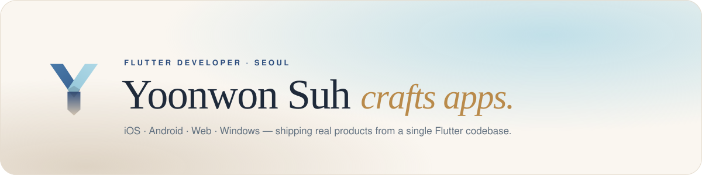
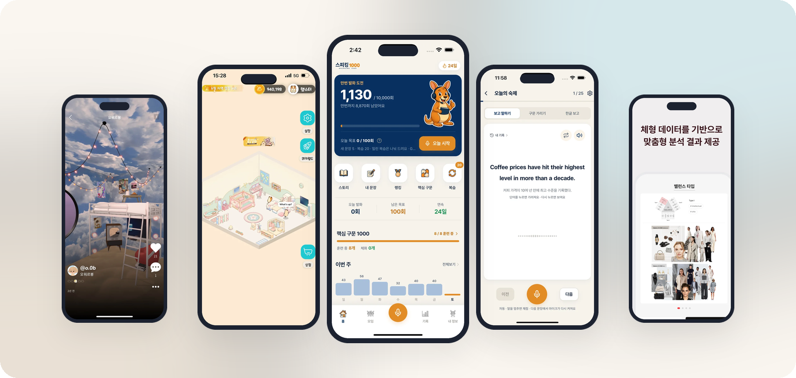

  

  
  

### 안녕하세요, 서윤원입니다 👋

사용자 경험과 완성도를 함께 고민하는 **Flutter 개발자**입니다.
iOS·Android·Web·Windows까지 하나의 코드베이스로 실서비스를 만들고 운영하며, 필요하면 백엔드·어드민·브랜드 디자인까지 직접 만듭니다.

- 🏢 **Remarkable Education** — Flutter Developer (2025.12 ~)
- 🚀 최근 출시: **스피킹1000** — 기획·디자인·앱·서버를 혼자 만들어 스토어에 올렸습니다
- 🤖 Claude Code 기반 **AI 에이전트 개발 워크플로우**를 실무에 쓰고, 사내 비개발자 대상 AI 활용 교육을 기획·강연합니다

  

### Selected Work

| | 프로젝트 | 한 줄 소개 | 스택 |
|:-:|---|---|---|
| 01 | **스피킹1000** [App Store](https://apps.apple.com/kr/app/id6823886168) · [Google Play](https://play.google.com/store/apps/details?id=com.speaking1000.app) · [Web](https://speaking1000.com) | 말하면 바로 채점되는 영어 발화 훈련 앱. 앱·백엔드·어드민·웹·브랜드까지 **100% 단독 구축** | Flutter · Riverpod · NestJS · Prisma · PostgreSQL · Cloud Run |
| 02 | **링키고 3.0** [App Store](https://apps.apple.com/kr/app/id6755289429) · [Google Play](https://play.google.com/store/apps/details?id=app.remarkable.reengkigo) | AI 영어 학습 앱 전담 개발. CustomPainter만으로 만든 **아이소메트릭 방 꾸미기 엔진**(쿼카룸), STT/TTS 발화 학습 | Flutter · CustomPainter · Rive · Rust FFI · Firebase |
| 03 | **링키톡** | 사내 고객지원 채팅 서비스. WebSocket 실시간 채팅 + AI 봇 핸드오프, **Web·Windows 단일 코드베이스** | Flutter Web · Windows · WebSocket · FCM |
| 04 | **링키고1 · Flash → Flutter Web** | 14GB 레거시 Flash 콘텐츠를 자동 추출 파이프라인으로 복원해 웹앱으로 재탄생 | Flutter Web · Python · FFDec |
| 05 | **TonePick** [tonepick.com](http://tonepick.com) | 퍼스널컬러 진단 앱. BLE 측색기 연동, AES-CBC 암호화 QR로 오프라인→온라인 결과 전달 | Flutter · BLE/GATT · Firebase · ML Kit |
| 06 | **퍼스널컬러 진단 키오스크** | 무인 진단·결제·출력 키오스크. 카드 단말(MethodChannel)·영수증 프린터 연동 | Flutter · MethodChannel · Bluetooth |
| 07 | **Picple** | 가상공간 플랫폼. Swift → Flutter 마이그레이션, Unity 임베드 메모리 누수 해결 | Flutter · Unity · FFmpeg |

> 대부분의 작업은 회사 비공개 저장소에 있습니다. 화면과 케이스 스터디는 **[yoonwonsuh.com](https://yoonwonsuh.com)** 에서 보실 수 있어요.

### Tech

  
  
  
  
  
  
  

  
  
  
  
  
  
  

